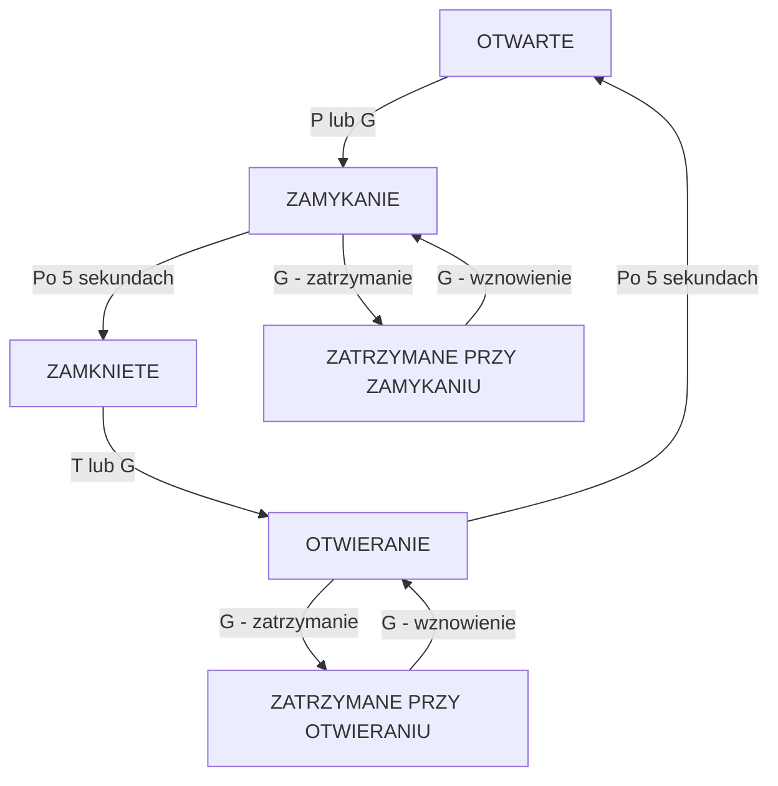

# System przejazdu kolejowego – maszyna stanów C++

## Opis projektu

Program jest konsolową symulacją sterowania przejazdem kolejowym. Działanie przejazdu opisuje maszyna stanów, która obsługuje otwieranie i zamykanie zapór, zatrzymywanie ich przez strażnika, symulowany czujnik ruchu, alarm oraz rejestr mandatów.

Sterowanie odbywa się bezpośrednio z klawiatury – nie trzeba wciskać klawisza Enter.

> **Uwaga:** Jest to projekt edukacyjny. Program symuluje działanie przejazdu i czujników. Nie steruje prawdziwymi zaporami ani nie wystawia rzeczywistych mandatów.

## Wykorzystane biblioteki

- `iostream` – obsługa wejścia i wyjścia w konsoli.
- `string` – przechowywanie opisów stanów i mandatów.
- `vector` – przechowywanie historii mandatów.
- `conio.h` – wykrywanie i odczytywanie klawiszy bez użycia Entera (`_kbhit()`, `_getch()`).
- `windows.h` – funkcje systemu Windows, m.in. `GetTickCount()`, `Sleep()` oraz typ `DWORD`.
- `cctype` – zamiana wielkich liter na małe (`tolower()`).

## Stany maszyny

Program wykorzystuje sześć stanów:

| Stan | Znaczenie |
|---|---|
| `OTWARTE` | Zapory są podniesione, przejazd jest otwarty. |
| `ZAMYKANIE` | Zapory są w trakcie opuszczania. |
| `ZAMKNIETE` | Zapory są opuszczone, przejazd jest zamknięty. |
| `OTWIERANIE` | Zapory są w trakcie podnoszenia. |
| `ZATRZYMANE_PRZY_ZAMYKANIU` | Strażnik zatrzymał zapory podczas zamykania. |
| `ZATRZYMANE_PRZY_OTWIERANIU` | Strażnik zatrzymał zapory podczas otwierania. |

### Przejścia między stanami



## Sterowanie klawiaturą

| Klawisz | Działanie |
|---|---|
| `P` | Rozpoczyna zamykanie zapór, gdy przejazd jest otwarty. |
| `T` | Symuluje przejazd pociągu i rozpoczyna otwieranie, gdy zapory są zamknięte. |
| `G` | Sterowanie strażnika: rozpoczyna zamykanie lub otwieranie, zatrzymuje zapory w ruchu albo wznawia zatrzymany ruch. |
| `M` | Przełącza stan symulowanego czujnika: wykryto obiekt / brak obiektu. |
| `V` | Symuluje wjazd pojazdu na przejazd i sprawdza, czy należy uruchomić alarm lub zapisać mandat. |
| `A` | Ręcznie uruchamia alarm. |
| `R` | Resetuje alarm, ale tylko wtedy, gdy czujnik nie wykrywa obiektu. |
| `H` | Wyświetla historię mandatów. |
| `?` | Ponownie wyświetla menu sterowania. |
| `Q` | Kończy działanie programu. |

Wielkość liter nie ma znaczenia – program rozpoznaje zarówno małe, jak i wielkie litery.

## Działanie zapór i pomiar czasu

Czas zamykania i otwierania jest ustawiony na 5 sekund. Wartości znajdują się na początku pliku `main.cpp`:

```cpp
const DWORD CZAS_ZAMYKANIA = 5000;
const DWORD CZAS_OTWIERANIA = 5000;
```

Wartości są podane w milisekundach, dlatego `5000` oznacza 5 sekund. Po upływie ustawionego czasu program automatycznie przechodzi do stanu `ZAMKNIETE` albo `OTWARTE` – nie trzeba potwierdzać zakończenia ruchu osobnym klawiszem.

Do pomiaru czasu program wykorzystuje `GetTickCount()` z biblioteki Windows. Gdy strażnik zatrzyma zapory klawiszem `G`, program zapamiętuje pozostały czas. Po ponownym naciśnięciu `G` ruch jest wznawiany z zachowaniem tego czasu.

## Czujnik ruchu i alarm

Czujnik jest symulowany klawiszem `M`:

- pierwsze naciśnięcie `M` oznacza wykrycie obiektu na przejeździe;
- kolejne naciśnięcie `M` oznacza, że obiekt opuścił przejazd.

Jeżeli czujnik wykryje obiekt, gdy stan przejazdu jest inny niż `OTWARTE`, program uruchamia alarm. Alarm można również uruchomić ręcznie klawiszem `A`.

Alarm można zresetować klawiszem `R`, gdy czujnik nie wykrywa już obiektu. Jeżeli obiekt nadal znajduje się na przejeździe, reset zostanie zablokowany.

## Wjazd pojazdu i mandaty

Klawisz `V` symuluje wjazd pojazdu. Reakcja programu zależy od aktualnego stanu:

| Stan przejazdu | Reakcja programu |
|---|---|
| `OTWARTE` | Wjazd jest dozwolony. |
| `ZAMYKANIE` lub `OTWIERANIE` | Uruchomienie alarmu i zapisanie mandatu w rejestrze. |
| `ZATRZYMANE_PRZY_ZAMYKANIU` lub `ZATRZYMANE_PRZY_OTWIERANIU` | Uruchomienie alarmu i zapisanie mandatu w rejestrze. |
| `ZAMKNIETE` | Uruchomienie alarmu; w obecnej wersji kodu mandat nie jest dodawany. |

Mandaty są przechowywane w wektorze `vector<string> mandaty`. Klawisz `H` wyświetla wszystkie wpisy oraz łączną liczbę mandatów.

**Historia mandatów istnieje tylko podczas działania programu.** Po zamknięciu programu dane z wektora są tracone – nie są zapisywane do pliku.

## Uruchomienie programu

Projekt jest przeznaczony dla systemu Windows, ponieważ wykorzystuje `conio.h` i `windows.h`.

1. Otwórz projekt w Code::Blocks lub innym środowisku obsługującym kompilator MinGW/GCC dla Windows.
2. Umieść kod w pliku `main.cpp`.
3. Skompiluj i uruchom program.
4. Steruj przejazdem za pomocą klawiszy opisanych w menu.

Program nasłuchuje klawiatury w pętli głównej. Do odczytu klawiszy używa `_kbhit()` i `_getch()`, dlatego nie wymaga zatwierdzania wyboru klawiszem Enter.

## Ograniczenia symulacji

- Czujnik ruchu jest przełączany ręcznie klawiszem `M`; nie jest podłączonym urządzeniem.
- Wjazd pojazdu jest symulowany klawiszem `V`.
- Zapory nie są fizycznymi urządzeniami – ich ruch jest reprezentowany przez stany i upływ czasu.
- Zatrzymanie przez strażnika zachowuje pozostały czas ruchu, ale program nie mierzy rzeczywistego położenia zapory.
- Mandaty są jedynie wpisami tekstowymi w pamięci programu.
- Program jest demonstracją maszyny stanów, a nie sterownikiem przeznaczonym do obsługi prawdziwego przejazdu kolejowego.
